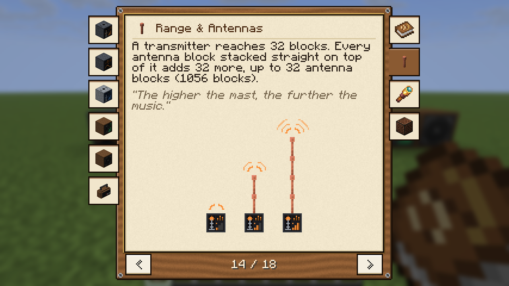
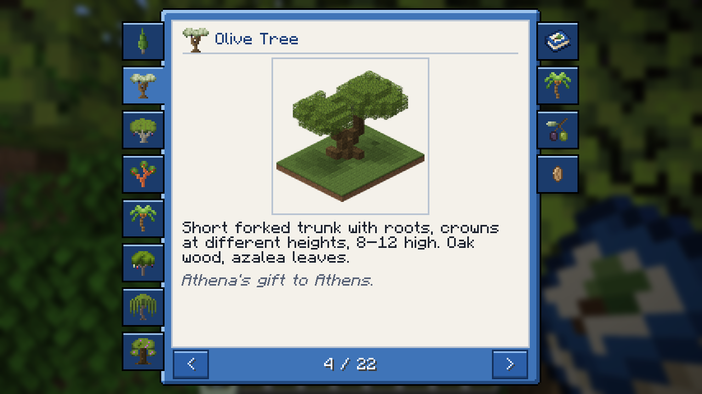

# BCF Guide Book Lib

The guide book of BaconCakeFactory's mods for Minecraft 1.21.1 (Fabric): one screen, one layout, one font and one way
to turn the pages, so every mod's book looks and works the same. A mod supplies its chapters and its colours; the
library is bundled inside the mod's jar, players install nothing extra.

| World Radio | Greek Trees |
|---|---|
|  |  |

## What the library does

- **The screen:** a panel with one page, chapter tabs on the left and right, arrows and the page number below. Pages
  turn with the tabs, the arrows, the arrow and page keys or the mouse wheel, and the book opens where it was closed.
- **Pages that break themselves:** chapters are lists of sections; a section that does not fit starts the next page,
  a heading moves over with what follows it. No text runs off a page, in any language.
- **Sections:** `Heading`, `Text`, `Quote`, `Note`, `ItemLine`, `Recipe`, `Pictures`, `ItemGrid`, `Break`.
- **Recipes** are read from the mod's own recipe files; a tag ingredient shows a stand-in.
- **The item:** `GuideBookItem` opens the screen; `Book.giveOnJoin()` gives every player one book, once.
- **Checks:** in the dev environment the log says `BOOK PAGES`, `BOOK OVERFLOW` (a section taller than a page) and
  `BOOK KEY MISSING`; `Book.missingKeys("en_us", "de_de")` is for a mod's self-test; `-Dbcf.guidebook.shots=<modid>[,<modid>]`
  saves every page as a screenshot.

## Using it in a mod

`gradle.properties`: `guide_book_version=1.0.0+1.21.1`. `build.gradle`:

```groovy
repositories {
    mavenLocal {
        content {
            includeGroup 'de.baconcakefactory'
        }
    }
}
dependencies {
    modImplementation "de.baconcakefactory:bcf-guide-book-lib:${project.guide_book_version}"
    include "de.baconcakefactory:bcf-guide-book-lib:${project.guide_book_version}"
}
```

`fabric.mod.json`: `"bcfguidebooklib": ">=1.0.0"` under `depends`. Then:

```java
public static final Book BOOK = Book.of(MOD_ID, BookTheme.builder()
        .panel(0xFF3F74B8, 0xFF9CC3EC, 0xFF234A80).page(0xFFF4F1EA, 0xFFB9C4D2).build(), GuideBook::chapters);
public static final Item GUIDE_BOOK = item("guide_book", props -> new GuideBookItem(props.stacksTo(1), BOOK));

static List<Chapter> chapters() {
    return List.of(new Chapter(BOOK.key("start"), new ItemStack(GUIDE_BOOK), Chapter.Side.RIGHT, List.of(
            new Section.Text(BOOK.key("start.text")), new Section.Heading(BOOK.key("heading.crafting")),
            BOOK.recipe("guide_book"))));
}
```

Texts are translation keys `<modid>.book.<name>`; the book's title is the item's name `item.<modid>.guide_book`.
What goes into which chapter is in the standards of
[bcf-mod-template](https://github.com/david-stefan-hermann/bcf-mod-template).

## Changing all books at once

The font, the line heights and the measures are `BookStyle`; the colours are each mod's `BookTheme`. Change
`BookStyle`, raise `mod_version`, run `./gradlew publishToMavenLocal`, raise `guide_book_version` in the mods and
build them. A player's game loads the newest version that any installed mod bundles, so the library stays backwards
compatible within a major version.

## Building

JDK 25 to run Gradle (the jar is built for Java 21), `./gradlew build publishToMavenLocal` → `build/libs/bcf-guide-book-lib-<version>.jar` and the copy in the
local Maven repository that the mods build against.

## License

MIT, see [LICENSE](LICENSE). By BaconCakeFactory.
